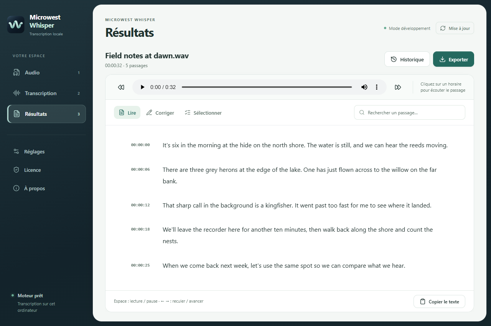

<p align="center">
  
</p>

<h1 align="center">Microwest Whisper</h1>

<p align="center">
  <strong>Transcribe recordings on your computer with Parakeet Ultra.</strong><br>
  Click a timestamp to hear the original audio, correct a passage, and export the transcript as text, Word, or subtitles.
</p>

<p align="center">
  <a href="https://github.com/DwennK/Microwest-whisper/releases/latest"></a>
  <a href="https://github.com/DwennK/Microwest-whisper/actions/workflows/build-release.yml"></a>
</p>

<p align="center">
  <a href="https://github.com/DwennK/Microwest-whisper/releases/latest/download/Microwest-Whisper-windows.exe"><strong>Download for Windows x64</strong></a>
  &nbsp;·&nbsp;
  <a href="https://github.com/DwennK/Microwest-whisper/releases/latest/download/Microwest-Whisper-mac.dmg"><strong>Download for Mac (Apple Silicon)</strong></a>
</p>

<p align="center">
  <br>
  <sub>A sample transcript in the French-language interface. Click a time in the left column to listen from that point.</sub>
</p>

<p align="center">
  <a href="#your-first-transcript">Quick start</a> ·
  <a href="#model-and-languages">Model and languages</a> ·
  <a href="#review-and-export">Review and export</a> ·
  <a href="#build-from-source">Build from source</a>
</p>

> The instructions below describe the current source on `main`. The linked installers are for the [latest published release](https://github.com/DwennK/Microwest-whisper/releases/latest).

## Your first transcript

1. Install the app and activate your **IA Swiss license**. If you already have Microwest Whisper, click **Update** in the top right to install the latest release.
2. Open **Audio** and choose a recording. MP3, M4A, WAV, FLAC, OGG, WebM, and MP4 are supported. Pick the folder where you want the transcript saved.
3. Download **Parakeet Ultra** when prompted (about 640 MiB), then click **Transcribe**. The installer includes the transcription engine and FFmpeg.
4. Open **Results** to review the text alongside the audio. Your output folder already contains the full transcript and subtitles.

Audio processing runs locally. You need an internet connection to activate your license and download a model. Once the model is installed, you can transcribe offline while your cached license is valid.

For Windows SmartScreen or macOS Gatekeeper prompts, see the [installation guide](docs/RELEASE_INSTALLATION.md). Each release includes signed update packages and [SHA-256 checksums](https://github.com/DwennK/Microwest-whisper/releases/latest/download/SHA256SUMS.txt).

## Model and languages

Parakeet Ultra runs on the CPU and detects the language of each recording automatically. Download the model (640 MiB) from **Audio** or **Settings**. The app verifies each file before installation. Existing Whisper preferences migrate to Parakeet when you upgrade. You can still open older transcripts and exports.

The interface follows your system language. To override it, open **Settings → Interface language** and choose a language by its native name. Choose **System language** to follow your computer again. The setting takes effect immediately and is saved on this device. It affects menus and messages and leaves the words in your transcript as recorded.

The app includes Bulgarian, Croatian, Czech, Danish, Dutch, English, Estonian, Finnish, French, German, Greek, Hungarian, Italian, Latvian, Lithuanian, Maltese, Polish, Portuguese, Romanian, Russian, Slovak, Slovenian, Spanish, Swedish, and Ukrainian. English is used when none of the system languages is supported.

## Transcribe several recordings

To transcribe several recordings, drop them on **Audio** or use **Choose files**. Set one output folder, check the order in the queue, and click **Transcribe**. You can move a recording up or remove it before starting. Each finished recording has its own exports and a **Read** button. If a recording fails, its error appears beside the filename and the queue continues. **Stop queue** interrupts the current recording. Click **Transcribe** again in the same session to retry unfinished files.

## Review and export

- **Follow the recording.** In reading mode, the current passage is highlighted and scrolls into view as the audio plays. Click a timestamp to listen again. Use the space bar to pause and the arrow keys to move back or forward five seconds.
- **Correct the transcript.** Choose **Edit** to edit a passage, then **Save edits** to update the full exports.
- **Keep an excerpt.** Choose **Select**, check the passages you need, and click **Export selection**. The excerpt is saved separately from the full transcript.
- **Reopen earlier work.** **History** lets you return to previous transcriptions in the current output folder.

| File | Contents |
| --- | --- |
| `.clean.txt` | Plain text for searching, copying, or pasting into notes. |
| `.transcript.docx` | A Word document for editing or sharing. |
| `.segments.srt` | Subtitles timed to the original recording. The current release timestamps speech without assigning speaker names. |

The default output folder is `Documents/Microwest Whisper/Transcriptions`. The app remembers a different folder if you choose one.

## Build from source

The desktop app uses Tauri 2, React, and Rust. FFmpeg converts the input to 16 kHz mono PCM. Parakeet runs through sherpa-onnx.

Install the [Tauri prerequisites for your platform](https://v2.tauri.app/start/prerequisites/), Node.js with npm, stable Rust, Python 3, CMake, and a C++ toolchain. The release workflow uses Node.js 26 and Python 3.15.

```sh
git clone https://github.com/DwennK/Microwest-whisper.git
cd Microwest-whisper
npm ci
python3 scripts/fetch-whispercpp-binaries.py
npm run dev
```

On Windows, use `py -3` in place of `python3`. Run `npm run build` to create a desktop installer for the current platform.

<details>
<summary><strong>Development settings and tests</strong></summary>

For a local debug session without license activation, use `MICROWEST_LICENSE_BYPASS=1 npm run dev` in a POSIX shell. In PowerShell, set `$env:MICROWEST_LICENSE_BYPASS = "1"` before running `npm run dev`. This setting applies only to debug builds.

| Environment variable | Purpose |
| --- | --- |
| `MICROWEST_MODEL_DIR` | Use a different model directory. |
| `MICROWEST_FFMPEG` | Use a local FFmpeg binary during development. |

```sh
npm test
npm run build:frontend
node --test scripts/check-release.mjs
cargo test --manifest-path src-tauri/Cargo.toml
python3 scripts/fetch-whispercpp-binaries.py --verify-manifest
```

</details>

<details>
<summary><strong>Model storage and cleanup</strong></summary>

| Platform | Default model directory |
| --- | --- |
| Windows | `%LOCALAPPDATA%\Microwest Whisper\models\` |
| macOS | `~/Library/Application Support/Microwest Whisper/models/` |
| Linux (development) | `~/.local/share/microwest-whisper/models/` |

Windows keeps downloaded models during an app update and removes them on a full uninstall. On macOS, remove models in **Settings** before deleting the app if you want to reclaim their disk space.

</details>

<details>
<summary><strong>How license validation works</strong></summary>

The app sends the license key, installation ID, and app version to the IA Swiss activation and validation endpoints at `https://licences.iaswiss.com/api/licenses`. The native backend checks an Ed25519-signed license before starting a transcription. The signed license normally lasts seven days. If the service is unreachable, the app can use it until it expires. An explicit rejection from the service revokes local access.

</details>

## Project guides

- [Native dependencies](docs/DEPENDENCIES.md) lists the pinned runtimes, models, and download sources.
- [Transcription backend](docs/TRANSCRIPTION.md) explains how the app finds binaries and models.
- [Release and updater guide](docs/UPDATER.md) covers version tags, signing, and publishing Windows and macOS installers.
- [Speaker identification proposal](docs/DIARIZATION_V2.md) describes the proposed diarization workflow.
- [Third-party notices](engine/whispercpp/THIRD_PARTY_NOTICES.md) identifies the licenses for the bundled engines and tools.
